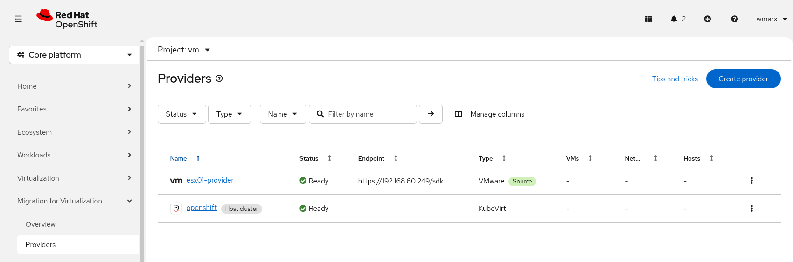

# Airgapped Environment OpenShift PoC

> **Private repository / dedicated PoC environment**
>
> This README is a Markdown representation of the original PoC document we created to the PoC in Berlin.
> The original wording, explanations, environment values and commands are "partially" intentionally retained.
> The PoC working directory used throughout this README is **`/var/poc-berlin`**. This is a private Repository.

---

## Table of Contents

1. [Overview](#overview)
2. [Network stuff in KVM](#network-stuff-in-kvm)
3. [VirtualBMC with OpenShift BMO](#virtualbmc-with-openshift-bmo)
4. [Overview Install Process of OpenShift](#overview-install-process-of-openshift)
5. [Local Registry for Airgapped Installation](#local-registry-for-airgapped-installation)
6. [Use OC-Mirror!](#use-oc-mirror)
7. [Installing OpenShift](#installing-openshift)
8. [After Installation - Day Two operations](#after-installation---day-two-operations)
9. [Login Process (Web UI & CLI)](#login-process-web-ui--cli)
10. [Install OpenShift Virtualization Operator via UI](#install-openshift-virtualization-operator-via-ui)
11. [Install Shared Storage](#install-shared-storage)
12. [Change internal OCP Registry (Ephemeral to Persistence)](#change-internal-ocp-registry-ephemeral-to-persistence)
13. [Networks in Kubevirt](#networks-in-kubevirt)
14. [External Identity Provider htpasswd](#external-identity-provider-htpasswd)
15. [Setting Up the OpenShift Update Service!](#setting-up-the-openshift-update-service)
16. [OpenShift Virtualization: Create RHEL VM's](#openshift-virtualization-create-rhel-vms)
17. [Create "Ubuntu/Debian/SuSE/FreeBSD" templates!](#create-ubuntudebiansusefreebsd-templates)
18. [Create Windows Machines!](#create-windows-machines)
19. [Setting Up VMWARE / MTV and Migrate VM's (Optional!)](#setting-up-vmware--mtv-and-migrate-vms-optional)
20. [Change the TLS Cert of a Local installed Quay registry (Optional!)](#change-the-tls-cert-of-a-local-installed-quay-registry-optional)
21. [Additional Worker Nodes (Optional!)](#additional-worker-nodes-optional)

---

# Overview

Purpose of this GitHub Repository:
This repository serves as a general Proof of Concept (PoC) for an OpenShift Virtualization
deployment on bare-metal infrastructure.

The deployment is executed using the Bare Metal Operator and the Agent-Based Installer
approach. This method combines the user-friendly workflow of the Assisted
Installer—commonly known from cloud environments—with the control of an
Infrastructure-Provisioned Infrastructure (IPI) deployment. By integrating with the hardware
layer via BMC (specifically the iDRAC interface in our setup), the system is aware of the
underlying physical infrastructure, enabling dynamic provisioning and seamless scaling of
additional worker nodes.

Note: Of course - although this is a private repository, it contains no credentials, secrets, or
sensitive customer data.

RHEL 9.x Access on our Bastion Host (Standard Installation! Don't use minimal Installation)  
```text
#storm4 (Alias for ssh access to my Remote Bastion Host)

On Bastion Host you need couple of OpenShift clients:

** oc
** oc-mirror  
** virtctl  
** openshift-install  
** skopeo  
** podman  
** jq / yq  
** git  
** tmux  
** vim  
** curl  

And execute:  
#oc completion bash > /dev/null && oc completion bash | sudo tee /etc/profile.d/bash_completion_oc.sh > /dev/null

```

Directory: Image Location on Storm4 for libvirt Images!
/var/lib/libvirt/images

Directory: Location for everything which we need for the PoC!
/var/poc-berlin

# Network stuff in KVM
Since, we're supposed to work really "offline" - disable the Internet Access on storm4 for the CoreOS Nodes:
```text
Disable Internet Access except for the NetApp (10.32.97.1 and 10.32.97.3)
#iptables -I FORWARD 1 -o enp132s0f0 -s 192.168.60.0/24 -d 10.32.97.1,10.32.97.3 -j ACCEPT
#iptables -A FORWARD -o enp132s0f0 -s 192.168.60.0/24 -j DROP

Access auf NetApp testen:
#oc debug node/ocp4-node1.pb-poc.ocp.berlin.test -- chroot /host nc -zvw3 10.32.97.1 2049
#oc debug node/ocp4-node1.pb-poc.ocp.berlin.test -- chroot /host nc -zvw3 10.32.97.3 443

Delete Rules - Activate again (if really necessary for some test stuff!)
#iptables -D FORWARD -o enp132s0f0 -s 192.168.60.0/24 -d 10.32.97.1,10.32.97.3 -j ACCEPT
#iptables -D FORWARD -o enp132s0f0 -s 192.168.60.0/24 -j DROP
```

## Create the 3 libvirt nets

### OpenShift Machine Network

```text
#virsh net-define /var/poc-berlin/ocp-net.xml
#virsh net-start ocp-net
#virsh net-autostart ocp-net
```

### VM-Network

```text
#virsh net-define /var/poc-berlin/vm-net.xml
#virsh net-start vtn-net
#virsh net-autostart vtn-net
```

### Provisioning-Network (Day2 Directory!)

```text
#virsh net-define /var/poc-berlin/day2/provisioning-net.xml
#virsh net-start vtn-net
#virsh net-autostart vtn-net
```
### Now, we should have 3 libvirt nets

Net1: ocp-net                    (install / machine network for LACP Install!)  
Net2: vtn-net                    (install / for virtual machines)  
Net3: provisioning-net           (BMH / Metal3, OpenShift)  

Optional: Delete a network! (Detach the Interfaces afterwards manually…
```text
#virsh net-destroy ocp-net 2>/dev/null
#virsh net-undefine ocp-net 2>/dev/null
```

Optional: And new again……
```text
#virsh net-define /var/poc-berlin/ocp-net.xml
#virsh net-start ocp-net
#virsh net-autostart ocp-net
```

## Create the 3 VM's with KVM/QEMU for my OpenShift Compact Cluster
ocp4-node1:  
```text
Storage Size Disk Device:
150GB

Memory / RAM:
32GB

CPU Assignmet:
8vCPU

SATA CDROM - Boot ISO OpenShift:
/PATH/agent.x86_64.iso (The Install ISO we creating later...)

Network Interfaces:
ocp-net / Leg1:         52:54:00:aa:bb:01
ocp-net / Leg2:         52:54:00:aa:bb:21
VM-Network:             52:54:00:5c:b6:a3
Prov. Network Ironic:   52:54:00:02:2d:fd

Boot Sequence:
1. VirtIO Disk
2. CDROM
3. NIC: First Leg "ocp-net" / 52:54:00:aa:bb:01
```
ocp4-node2:  
```text
Storage Size Disk Device:
150GB

Memory / RAM:
32GB

CPU Assignmet:
8vCPU

SATA CDROM - Boot ISO OpenShift:
/PATH/agent.x86_64.iso (The Install ISO we creating later...)

Network Interfaces:
ocp-net / Leg1:         52:54:00:aa:bb:02
ocp-net / Leg2:         52:54:00:aa:bb:22
VM-Network:             52:54:00:ab:fe:cb
Prov. Network Ironic:   52:54:00:fb:3e:4b

Boot Sequence:
1. VirtIO Disk
2. CDROM
3. NIC: First Leg "ocp-net" / 52:54:00:aa:bb:02
```

ocp4-node3:  
```text
Storage Size Disk Device:
150GB

Memory / RAM:
32GB

CPU Assignmet:
8vCPU

SATA CDROM - Boot ISO OpenShift:
/PATH/agent.x86_64.iso (The Install ISO we creating later...)

Network Interfaces:
ocp-net / Leg1:         52:54:00:aa:bb:03
ocp-net / Leg2:         52:54:00:aa:bb:23
VM-Network:             52:54:00:64:e5:9d
Prov. Network Ironic:   52:54:00:62:ba:2c

Boot Sequence:
1. VirtIO Disk
2. CDROM
3. NIC: First Leg "ocp-net" / 52:54:00:aa:bb:03
```

## Attach Interfaces for all 3 libvirt networks!

Hybrid Nodes (Compact Cluster Nodes, Control Plane & Worker)
The MAC addresses we got from the VM Configuration!
```text
OCP Net - Leg-1:
#virsh attach-interface --domain ocp4-node1 --type network --source ocp-net --model virtio --mac 52:54:00:aa:bb:01 --config --live
#virsh attach-interface --domain ocp4-node2 --type network --source ocp-net --model virtio --mac 52:54:00:aa:bb:02 --config --live
#virsh attach-interface --domain ocp4-node3 --type network --source ocp-net --model virtio --mac 52:54:00:aa:bb:03 --config --live
```
```text
OCP Net - Leg-2:
#virsh attach-interface --domain ocp4-node1 --type network --source ocp-net --model virtio --mac 52:54:00:aa:bb:21 --config --live
#virsh attach-interface --domain ocp4-node2 --type network --source ocp-net --model virtio --mac 52:54:00:aa:bb:22 --config --live
#virsh attach-interface --domain ocp4-node3 --type network --source ocp-net --model virtio --mac 52:54:00:aa:bb:23 --config --live
```
```text
VTN-Net:
#virsh attach-interface --domain ocp4-node1 --type network --source vtn-net --model virtio --mac 52:54:00:5c:b6:a3 --config --live
#virsh attach-interface --domain ocp4-node2 --type network --source vtn-net --model virtio --mac 52:54:00:ab:fe:cb --config --live
#virsh attach-interface --domain ocp4-node3 --type network --source vtn-net --model virtio --mac 52:54:00:64:e5:9d --config --live
```
```text
Provisioning Network:
#virsh attach-interface --domain ocp4-node1 --type network --source provisioning-net --model virtio --mac 52:54:00:02:2d:fd --config --live
#virsh attach-interface --domain ocp4-node2 --type network --source provisioning-net --model virtio --mac 52:54:00:fb:3e:4b --config --live
#virsh attach-interface --domain ocp4-node3 --type network --source provisioning-net --model virtio --mac 52:54:00:62:ba:2c --config --live
```

Optional: Two additional Worker Nodes
```text
OCP Net - Leg-1:
#virsh attach-interface --domain ocp4-node4 --type network --source ocp-net --model virtio --mac 52:54:00:01:c6:89 --config --live
#virsh attach-interface --domain ocp4-node5 --type network --source ocp-net --model virtio --mac 52:54:00:dd:ed:70 --config --live
```
```text
OCP Net - Leg-2:
#virsh attach-interface --domain ocp4-node4 --type network --source ocp-net --model virtio --mac 52:54:00:aa:bb:24 --config --live
#virsh attach-interface --domain ocp4-node5 --type network --source ocp-net --model virtio --mac 52:54:00:aa:bb:25 --config --live
```
```text
VTN-Net:
#virsh attach-interface --domain ocp4-node4 --type network --source vtn-net --model virtio --mac 52:54:00:db:03:17 --config --live
#virsh attach-interface --domain ocp4-node5 --type network --source vtn-net --model virtio --mac 52:54:00:d4:b4:1c --config --live
```
```text
# Provisioning Network:
#virsh attach-interface --domain ocp4-node4 --type network --source provisioning-net --model virtio --mac 52:54:00:b2:03:ce --config
#virsh attach-interface --domain ocp4-node5 --type network --source provisioning-net --model virtio --mac 52:54:00:c9:c6:76 --config
```

### Optional: Example - In the case - we have to detach these interfaces again...
Figure out the MAC addresses:
```text
#virsh domiflist ocp4-node1
#virsh domiflist ocp4-node2
#virsh domiflist ocp4-node3
#virsh domiflist ocp4-node4 (reserved worker node!)
#virsh domiflist ocp4-node5 (reserved worker node!)
```

Or do just:
```text
#for node in ocp4-node1 ocp4-node2 ocp4-node3 ocp4-node4 ocp4-node5; do
  echo "------------"
  virsh domiflist $node | awk -v n="$node" '/ocp-net|provisioning-net|vtn-net/ {printf "%-12s | %-18s | %s\n", n, $3, $5}'
done; echo "------------"
```

### Optional: Remove the Interfaces (example):
```text
#virsh detach-interface --domain ocp4-node1 --type network --mac 52:54:00:xx:xx:xx --config --live
#virsh detach-interface --domain ocp4-node2 --type network --mac 52:54:00:xx:xx:xx --config --live
#virsh detach-interface --domain ocp4-node3 --type network --mac 52:54:00:xx:xx:xx --config --live
```

### Network Node Config (virsh)

```text
# virsh domiflist --domain ocp4-node1
 Interface Type            Source              Model MAC
----------------------------------------------------------------------
 network                   ocp-net             virtio 52:54:00:aa:bb:01
 network                   ocp-net             virtio 52:54:00:aa:bb:21
 network                   vtn-net             virtio 52:54:00:5c:b6:a3
 network                   provisioning-net    virtio 52:54:00:02:2d:fd
```

```text
# virsh domiflist --domain ocp4-node2
 Interface Type            Source              Model MAC
----------------------------------------------------------------------
 network                   ocp-net             virtio 52:54:00:aa:bb:02
 network                   ocp-net             virtio 52:54:00:aa:bb:22
 network                   vtn-net             virtio 52:54:00:ab:fe:cb
 network                   provisioning-net    virtio 52:54:00:fb:3e:4b
```

```text
# virsh domiflist --domain ocp4-node3
 Interface Type            Source              Model MAC
----------------------------------------------------------------------
 network                   ocp-net             virtio 52:54:00:aa:bb:03
 network                   ocp-net             virtio 52:54:00:aa:bb:23
 network                   vtn-net             virtio 52:54:00:64:e5:9d
 network                   provisioning-net    virtio 52:54:00:62:ba:2c
```

```text
# virsh domiflist --domain ocp4-node4 (Optional, this node is not there yet!)
 Interface Type            Source              Model MAC
----------------------------------------------------------------------
 network                   ocp-net             virtio 52:54:00:01:c6:89
 network                   ocp-net             virtio 52:54:00:aa:bb:24
 network                   vtn-net             virtio 52:54:00:db:03:17
 network                   provisioning-net    virtio 52:54:00:b2:03:ce

#virsh domiflist --domain ocp4-node5 (Optional, this node is not there yet!)
 Interface Type            Source              Model MAC
----------------------------------------------------------------------
 network                   ocp-net             virtio 52:54:00:dd:ed:70
 network                   ocp-net             virtio 52:54:00:aa:bb:25
 network                   vtn-net             virtio 52:54:00:d4:b4:1c
 network                   provisioning-net    virtio 52:54:00:c9:c6:76

Fast Check for all nodes in regards of ALL, incl. the two install leg interfaces (the later bond
interface in OpenShift:
#for node in ocp4-node1 ocp4-node2 ocp4-node3 ocp4-node4 ocp4-node5; do
  echo "=== Schnittstellen für $node ==="
  virsh domiflist "$node" | grep -E "ocp-net|provisioning-net|vtn-net"
  echo ""
done
```

Fast Check for all MAC Addresses on the VM’s
```text
#for node in ocp4-node1 ocp4-node2 ocp4-node3 ocp4-node4 ocp4-node5; do
  echo "------------"
  virsh domiflist "$node" | awk -v n="$node" '/ocp-net|provisioning-net|vtn-net/ {
    printf "%-12s | %-18s | %s\n", n, $3, $5
  }'
done
echo "------------"
```

Status Check all Networks in KVM
```text
#virsh net-list --all
```

## Expected Outcome:
```text
ocp-net               active yes        yes  
provisioning-net      active yes        yes  
vtn-net               active yes        yes
```
If we have trouble creating the "provisioning-net" net as internal switch the "virbr-prov" IF didn't get created:
```text
#nmcli connection add type bridge con-name virbr-prov ifname virbr-prov autoconnect yes
#nmcli connection up virbr-prov
```

## Create Network Bond with VLAN ovp-net & vtn-net

To enable OpenShift nodes in the PoC to communicate across tagged VLANs on a Linux
hypervisor we configure the host network and the hypervisor’s (KVM/libvirt) built-in
DHCP/DNS service to recognize VLAN traffic.

First, we create a tagged VLAN sub-interface (virbr1.40) on top of our existing virtual
bridge (virbr1) and assign the host IP address (192.168.60.1). Because this sub-interface
uses a single-host mask, we add explicit static routes telling the host OS that traffic destined
for our OpenShift nodes and API endpoints (.10 through .15 and .20) must travel through this
specific VLAN 40 path.

Finally - because libvirt's embedded DHCP and DNS server (dnsmasq) only listens on base
bridge interfaces by default we update the virtual network XML file (ocp-net.xml and
vm-net.xml) to explicitly bind dnsmasq to our new VLAN sub-interfaces (virbr1.40 for the
machine network and virbr2.100 for the VM Network). This ensures that when virtual
machines boot up and request IP addresses over tagged VLAN traffic, dnsmasq captures
those requests and hands out the proper DHCP leases.

### VLAN40 - ocp-net (virbr1.40)

```text
# Create the VLAN 40 profile with link-local IP
nmcli connection add type vlan con-name virbr1.40 ifname virbr1.40 dev virbr1 id 40 ipv4.method manual ipv4.addresses 192.168.60.1/32 connection.zone trusted
```

```text
# Add the persistent host routes (including .14 and .15)
nmcli connection modify virbr1.40 +ipv4.routes "192.168.60.11/32, 192.168.60.12/32, 192.168.60.13/32, 192.168.60.14/32, 192.168.60.15/32, 192.168.60.10/32, 192.168.60.20/32, 192.168.60.249/32"
```

```text
# Bring the interface up
nmcli connection up virbr1.40
```

And add that in the ocp-net.xml File for the libvirt Net:
```text
<network xmlns:dnsmasq='http://libvirt.org/schemas/network/dnsmasq/1.0'>
 <dnsmasq:options>
  <dnsmasq:option value="interface=virbr1.40"/>
 </dnsmasq:options>
</network>
```

### VLAN100 - vtn-net

```text
# Create the VLAN 100 profile with link-local IP
nmcli connection add type vlan con-name virbr2.100 ifname virbr2.100 dev virbr2 id 100
ipv4.method manual ipv4.addresses 192.168.70.1/32 connection.zone trusted
```

```text
# Add the persistent host routes (including .14 and .15)
nmcli connection modify virbr2.100 +ipv4.routes "192.168.70.11/32, 192.168.70.12/32,
192.168.70.13/32, 192.168.70.14/32, 192.168.70.15/32"
```

```text
# Bring the interface up
nmcli connection up virbr2.100
```

And add that in the ocp-net.xml File for the libvirt Net:
```text
<network xmlns:dnsmasq='http://libvirt.org/schemas/network/dnsmasq/1.0'>
 <dnsmasq:options>
  <dnsmasq:option value="interface=virbr2.100"/>
 </dnsmasq:options>
</network>
```

Optional: To delete the connections again
```text
#nmcli connection delete virbr1.40 2>/dev/null
#nmcli connection delete virbr2.100 2>/dev/null
```

--------------------------------------------------------------------------------------------------
Bit of Troubleshoooting….
```text
#tcpdump -nn -i any "host (192.168.60.1 or 192.168.60.11) and (port 53 or port 5000 or icmp
or port 22)"
```
# VirtualBMC with OpenShift BMO

Run Metal3 with VBMC and KVM  
Simulate baremetal servers - Create a virtual baremetal environment to “test” baremetal  
cloud services such as Cluster API Provider Metal3, Ironic and Bare Metal Operator  

### Components of OpenShift Metal3

Cluster-Baremetal-Operator (CBO):
The operator manages and monitors Metal3 services on control plane nodes based on
deployment configs.

BareMetalHost (BMH):
A Custom Resource representing a physical server, storing its online status, MAC addresses,
and BMC credentials. The Server is “stored” in the OCP Database for later use if needed for
additional utilization.

Ironic:
The underlying service (original from OpenStack) handles hardware inspection, PXE booting,
and image deployment.


### Configure VirtualBMC on storm4

Create a Python virtual environment and install virtualbmc:
```text
#sudo python3 -m venv /opt/vbmc --system-site-packages
#source /opt/vbmc/bin/activate
#pip install virtualbmc
```

Create the vbmc service:
```text
#vim /etc/systemd/system/vbmcd.service
#systemctl daemon-reload
#systemctl start vbmcd
#systemctl status vbmcd
```

Start the virtual BMC daemon
```text
#vbmc
#vbmc list
```

Register existing Nodes!
```text
#vbmc add ocp4-node1 --address 192.168.60.1 --port 6234 --libvirt-uri qemu:///system
--username wmarx --password redhat
#vbmc add ocp4-node2 --address 192.168.60.1 --port 6235 --libvirt-uri qemu:///system
--username wmarx --password redhat
#vbmc add ocp4-node3 --address 192.168.60.1 --port 6236 --libvirt-uri qemu:///system
--username wmarx --password redhat
```

Worker Nodes, second MachineSet - doing that later! (Optional!)

```text
#vbmc add ocp4-node4 --address 192.168.60.1 --port 6237 --libvirt-uri qemu:///system
--username wmarx --password redhat
#vbmc add ocp4-node5 --address 192.168.60.1 --port 6238 --libvirt-uri qemu:///system
--username wmarx --password redhat
```

Start the BMC service for this VM’s
```text
vbmc start ocp4-node1
vbmc start ocp4-node2
vbmc start ocp4-node3
vbmc start ocp4-node4
vbmc start ocp4-node5
```

### Verify the IPMI Interface

Test: Query status of ocp4-node1
```text
#ipmitool -I lanplus -H 192.168.60.1 -U wmarx -P redhat -p 6234 power status
#ipmitool -I lanplus -H 192.168.60.1 -U wmarx -P redhat -p 6234 power on
#ipmitool -I lanplus -H 192.168.60.1 -U wmarx -P redhat -p 6234 power off
```

# Overview Install Process of OpenShift

## Architectural Summary
```text
Nodes:                       3 Compact Nodes (Master + Worker role combined)
Ingress Virtual IPs (VIPs):  192.168.60.20
API VIP:                     192.168.60.10
Node IPs:
 - ocp4-node1.poc.ocp.berlin.test: 192.168.60.11 (Rendezvous Host!!)  
 - ocp4-node2.poc.ocp.berlin.test: 192.168.60.12  
 - ocp4-node3.poc.ocp.berlin.test: 192.168.60.13
```

## Design / Architecture

### 1. Input Dependencies (Configuration Fields)

The configuration data is divided into three distinct functional categories:

- Core configuration files required for any OpenShift cluster, which include:
  - Cluster name (the unique identifier for the cluster, e.g., cluster1)
  - Base domain (the DNS domain for routing, e.g., companyname.com)
  - Pull secret (for authenticating against Red Hat registries)
  - SSH key (the public key of the administrator used for troubleshooting access)

- Infrastructure-specific configuration containing details about:
  - Platform (the underlying virtualization provider or bare-metal environment)

  - Platform info (infrastructure-specific access credentials)

- Advanced configurations for tuning the environment:
  - Node configuration (defining machine pools, specific settings for control plane,
            and compute nodes)

### 2. The Processing Engine (install-config.yaml)

These inputs are aggregated and processed through two primary stages:
   1. install-config.yaml: This is the master configuration file where all the dependencies
       mentioned above are defined and declared.
   2. Ignition: The installation utility consumes the install-config.yaml file to generate
       low-level machine-readable boot configuration files (called Ignition files).

### 3. Installation Targets

During the host boot phase, the Ignition configuration is consumed to provision and configure
the targeted cluster hosts. These target nodes are categorized into three roles:

- Bootstrap node: A temporary node configured to orchestrate the cluster initialization.
      It hosts a temporary Kubernetes API server to build the permanent control plane and
      is destroyed once the installation finishes.
- Control plane (Master nodes): Highly available nodes running Kubernetes
      control-plane components (such as API-server, controllers, schedulers) and the etcd
      state database.
- Compute nodes (Worker nodes): Nodes responsible for running actual user
      applications and workloads.

# Local Registry for Airgapped Installation

## TLS Certs Registry

### Working dir on Storm4

```text
#mkdir -p /var/poc-berlin/{certs,data,metadata,workspace}
#cd /var/poc-berlin
```

### TLS-Certs for local Registry

```text
#openssl req -newkey rsa:4096 -nodes -sha256 \
  -keyout /var/poc-berlin/certs/domain.key \
  -x509 -days 365 \
  -out /var/poc-berlin/certs/domain.crt \
  -subj "/CN=storm4.ocp.berlin.test" \
  -addext "subjectAltName=DNS:storm4.ocp.berlin.test,IP:192.168.60.1"
```

## Podman Registry

### Start Podman Cocker Registry

Image we need:
```text
#podman inspect docker.io/library/registry:2 --format '{{.RepoTags}} {{.Digest}}'
```

Test it:
```text
#podman run --rm \
  --entrypoint echo \
  -p 5000:5000 \
  -v /var/poc-berlin/data:/var/lib/registry:z \
  -v /var/poc-berlin/certs:/certs:z \
  -e REGISTRY_HTTP_TLS_CERTIFICATE=/certs/domain.crt \
  -e REGISTRY_HTTP_TLS_KEY=/certs/domain.key \
  docker.io/library/registry:2 \
  "Syntax and flags are valid!"
```

Run it!
```text
#podman run -d \
  --name local-registry \
  --restart=always \
  -p 5000:5000 \
  -v /var/poc-berlin/data:/var/lib/registry:z \
  -v /var/poc-berlin/certs:/certs:z \
  -e REGISTRY_HTTP_TLS_CERTIFICATE=/certs/domain.crt \
  -e REGISTRY_HTTP_TLS_KEY=/certs/domain.key \
  docker.io/library/registry:2
```

Copy whole Directory to USB Harddisk
```text
#rsync -avzP --inplace --exclude='*pinned_*.yaml' root@storm4.local:/var/poc-berlin/ /home/wmarx/po-berlin/harddisk/var/poc-berlin/
```

### Take the docker.io/library/registry:2 with you!

Download the Registry Image & save it
```text
#podman pull docker.io/library/registry:2
#podman tag docker.io/library/registry:2 local-poc-registry:2
#podman save -o /var/poc-berlin/harddisk-test/registry-image.tar local-poc-registry:2
```

Load the Image in the air-gapped env!
```text
#podman load -i /var/poc-berlin/harddisk-test/registry-image.tar
```
You might inspect the registry now, is now “local” - ignore the docker.io address….
```text
#podman inspect local-poc-registry:2
```

Start Container Image/Registry airgapped!
```text
#podman run -d \
  --name local-registry \
  --restart=always \
  -p 5000:5000 \
  -v /var/poc-berlin/data:/var/lib/registry:z \
  -v /var/poc-berlin/certs:/certs:z \
  -e REGISTRY_HTTP_TLS_CERTIFICATE=/certs/domain.crt \
  -e REGISTRY_HTTP_TLS_KEY=/certs/domain.key \
  local-poc-registry:2
```

### Test Commands Registry Tests

#### Up and running?
```text
#curl -vk https://storm4.ocp.berlin.test:5000
```

#### Disable Default Catalog sources to make sure nothing runs via the deafaults!
```text
#oc patch OperatorHub cluster --type json -p '[{"op": "add", "path": "/spec/disableAllDefaultSources", "value": true}]'
```

#### Further Tests!
```text
#curl -k https://storm4.ocp.berlin.test:5000/v2/_catalog | jq .
#curl -k https://storm4.ocp.berlin.test:5000/v2/openshift/release/openshift/release-images/tags/list | jq .
```

#### Pull Test
```text
#podman pull --tls-verify=false storm4.ocp.berlin.test:5000/openshift/release/openshift/release-images:4.22.10-x86_64
```

#### Memory Check in /var

```text
#du -sh /var/poc-berlin/data /var/poc-berlin/workspace
```

# Use OC-Mirror!

```text
#curl -O https://mirror.openshift.com/pub/openshift-v4/clients/ocp/latest/oc-mirror.tar.gz && tar -xzf oc-mirror.tar.gz -C /usr/local/bin/ && chmod +x /usr/local/bin/oc-mirror
```

## Start mirror to local Registry

### Figure out the actual OpenShift release

```text
#curl -sH "Accept: application/json" "https://api.openshift.com/api/upgrades_info/v1/graph?channel=stable-4.22" | jq -r '.nodes[].version' | sort -V | tail -n 1
```

Client Download See also OCP Mirror Red Hat (For installer, oc, oc mirror,....):  
https://mirror.openshift.com/pub/openshift-v4/x86_64/clients/ocp/stable-4.22/

Server / Core OS Images:  
https://mirror.openshift.com/pub/openshift-v4/amd64/dependencies/rhcos/4.22/latest/

File for image download:  
/var/poc-berlin/imageset-oc-mirror-config.yaml >> File, maybe update the “maxVersion” to the actual
minor Version!!

### Figure out if an operator is really there
Example:  
```text
#oc-mirror --v2 list operators --catalog=registry.redhat.io/redhat/redhat-operator-index:v4.22 | grep -E 'cluster-logging|advanced-cluster-management|multicluster-engine|node-healthcheck|fence-agents|self-node'
```

### Image Mirror with oc-mirror

First time to replicate!
```text
#oc-mirror \
  -c /var/poc-berlin/imageset-oc-mirror-config.yaml \
  --workspace file:///var/poc-berlin/workspace \
  --authfile /var/poc-berlin/auth.json \
  --dest-tls-verify=false \
  docker://storm4.ocp.berlin.test:5000/openshift/release \
  --v2
```

### Check Manifests in the Image Workspace

```text
oc-mirror generated for ImageContentSourcePolicy (ICSP) eg. ImageDigestMirrorSet (IDMS - oc-mirror V2)
Files:
#ls -la /var/poc-berlin/workspace/working-dir/cluster-resources
```
Second time - after updating the imageset-oc-mirror-config.yaml file!  
In the case errors happen - change parallel-images & parallel-layers to 1 or 2.  
```text
#oc-mirror \
  -c /var/poc-berlin/imageset-oc-mirror-config.yaml \
  --workspace file:///var/poc-berlin/workspace \
  --authfile /var/poc-berlin/auth.json \
  --dest-tls-verify=false \
  --retry-times 10 \
  --parallel-images 8 \
  --parallel-layers 8 \
  docker://storm4.ocp.berlin.test:5000/openshift/release
  --v2
```

### Alternative - mirror a single Image with "oc image mirror"!   
Find out the latest 3 tags of an image you want to pull in the offline registry:  
```text
#skopeo list-tags docker://registry.redhat.io/cert-manager/cert-manager-operator-rhel9 --authfile /var/poc-berlin/auth.json | jq -r '.Tags[-3:]'
```
Than you can download a single Image with "oc image" - means with the original OpenShift Command Line Tool
```text
#oc image mirror registry.redhat.io/cert-manager/cert-manager-operator-rhel9:v1.20.1 storm4.ocp.berlin.test:5000/openshift/release/cert-manager/cert-manager-operator-rhel9:v1.20.1 --insecure=true
```
### Sync new Sources
Sync the new Sources & catalogs AFTER doing oc-mirror - all manifest are getting created automatically in:  
/var/poc-berlin/workspace/working-dir/cluster-resources/  
```text
Either do single files (Like the cs-files and idms file). cc=Community Catalog  //  cs=Certified Store
#oc apply -f /var/poc-berlin/workspace/working-dir/cluster-resources/cs-redhat-operator-index-v4-22.yaml
#oc apply -f /var/poc-berlin/workspace/workspace/working-dir/cluster-resources/idms-oc-mirror.yaml

Or just do the whole directory:
#oc apply -f /var/poc-berlin/workspace/working-dir/cluster-resources/
```

```text
#rsync -avzP --inplace --exclude='*pinned_*.yaml' root@storm4.local:/var/poc-berlin/ /home/wmarx/po-berlin/harddisk/var/poc-berlin/
```

Optional: Copy the Delta-Data to USB Harddisk
```text
#rsync -avzP --inplace --exclude='*pinned_*.yaml' root@storm4.local:/var/poc-berlin/ /home/wmarx/po-berlin/harddisk/var/poc-berlin/
```
### Optional: IDMS And ITMS Files (ImageDigestMirrorSet / ImageTagMirrorSet)
When changing or renaming target registries, you must purge and regenerate the ImageDigestMirrorSet (IDMS) and ImageTagMirrorSet (ITMS) manifests!    
These files have been generated with "oc-mirror" after executing it the first time!  
/var/poc-berlin/workspace/working-dir/cluster-resources/
```text
#oc get idms
#oc get itms

If any resources are there after renaming or switching registries:
#oc delete idms --all
#oc delete itms --all

And then:
#oc apply -f /var/poc-berlin/workspace/working-dir/cluster-resources/

Verification:
Run '#oc get idms' and '#oc get itms' to confirm all image mirrors now resolve to the new registry host.
We still need "itms" since we using additionalImages with tags like "latest" in the imageset-oc-mirror-config.yaml file.
```

## Pack your registry workspace and take it to the PoC!

Copy Registry the external USB Disk!
```text
#cp -r /var/poc-berlin/* /external-usb-disk/ocp-airgap-poc
```

Mirror external Bastion Host! Maybe the NAME is gonna change!
```text
##oc-mirror \
  -c /var/poc-berlin/imageset-oc-mirror-config.yaml \
  --workspace file:///var/poc-berlin/workspace \
  --authfile /var/poc-berlin/auth.json \
  --dest-tls-verify=false \
  --retry-times 10 \
  --parallel-images 2 \
  --parallel-layers 2 \
  docker://storm4.ocp.berlin.test:5000/openshift/release \
  --v2
```
## Optional: How to delete old images with oc-mirror! 
[OpenShift Documentation - Deleting old Image stuff with oc-mirror](https://docs.openshift.com/it/documentation/openshift_container_platform/4.22/html/disconnected_environments/about-installing-oc-mirror-v2#oc-mirror-workflows-delete-v2_about-installing-oc-mirror-v2)  
In oc-mirror v2, image deletion is a two-step workflow using a DeleteImageSetConfiguration file. Unlike v1, v2 does not prune images automatically, giving you explicit control to avoid accidental data loss.  
```text
Example Deletion File:
apiVersion: mirror.openshift.io/v2alpha1
kind: DeleteImageSetConfiguration
delete:
  platform:
    channels:
      - name: stable-4.22
        minVersion: 4.22.10
        maxVersion: 4.22.12
  additionalImages:
    - name: docker.io/library/busybox:latest

Then, generate the Delete Manifest:
oc-mirror delete -c delete-config.yaml --workspace file:///var/poc-berlin/workspace --v2 --generate docker://storm4.ocp.berlin.test:5000/openshift/release
```

# Installing OpenShift

#### 0. URL's 

- [OpenShift Documentation - Installation & Update](https://docs.redhat.com/en/documentation/openshift_container_platform/4.22/html/architecture/architecture-installation)
- [Installing an on-premise cluster with the Agent-based Installer](https://docs.redhat.com/en/documentation/openshift_container_platform/4.22/html/installing_an_on-premise_cluster_with_the_agent-based_installer/preparing-to-install-with-agent-based-installer#agent-based-installer-recommended-resources_preparing-to-install-with-agent-based-installer)
- [Deploying OpenShift Container Platform clusters with virtualized control planes](https://docs.redhat.com/en/documentation/openshift_container_platform/4.22/html-single/virtualized_control_planes/index#vcp-overview)
- [Red Hat Docu / Bonds with agent-config.yaml](https://docs.redhat.com/en/documentation/openshift_container_platform/4.22/html/installing_an_on-premise_cluster_with_the_agent-based_installer/preparing-to-install-with-agent-based-installer)
- [API Docu - Provisioning [metal3.io/v1alpha1]](https://docs.redhat.com/en/documentation/openshift_container_platform/4.22/html/provisioning_apis/provisioning-metal3-io-v1alpha1)
- [Under the hood of OpenShift update mechanism](https://rubenrodrigues.fr/under-the-hood-of-ocp-upgrade-mechanism/)
- [Latest technical articles & videos, Like Let's Encrypt u.a.](https://www.certdepot.net/))

## First, create auth.json & set your variables (.bashrc)

Create Authfile (We need pull-secret,RH registry, Podman Registry):  
```text
Create the empty File:
#echo '{}' > /var/poc-berlin/auth.json // Create auth file with an empty json object!
```

#### 1. Mein Pull Secret in Auth File einfügen:
```text
printf '%s\n' '[PULL_SECRET from console.redhat.com]' > /var/poc-berlin/auth.json
```
#### 2. Red Hat Registry Login
```text
#podman login registry.redhat.io --authfile /var/poc-berlin/auth.json
```

#### 3. Quay.io Release Login (wird für das Release-Image benötigt)
```text
#podman login quay.io --authfile /var/poc-berlin/auth.json
```

#### 4. Login PoC Offline Registry: Give auth file to local Registry
```text
#podman login storm4.ocp.berlin.test:5000 --tls-verify=false --authfile /var/poc-berlin/auth.json
```
#### 5. Fixing the environment variables 

```text
# Read variables from /var/poc-berlin (for the two install Files!)
SSH_KEY=$(cat ~/.ssh/id_ed25519.pub 2>/dev/null || cat ~/.ssh/id_rsa.pub)
REGISTRY_CA=$(cat /var/poc-berlin/certs/domain.crt)
PULL_SECRET=$(cat /var/poc-berlin/auth.json | tr -d '\n')

Or fix via entries in our local .bashrc:
export SSH_KEY=$(cat ~/.ssh/id_ed25519.pub 2>/dev/null || cat ~/.ssh/id_rsa.pub)
export REGISTRY_CA=$(cat /var/poc-berlin/certs/domain.crt)                     
export PULL_SECRET=$(cat /var/poc-berlin/auth.json | tr -d '\n')
export KUBECONFIG=/var/poc-berlin/installer/auth/kubeconfig

```

## Install Config & Agent Config

#### 1. Create install-config.yaml (/var/poc-berlin)

This mirrors all default domains (quay.io and registry.redhat.io) exclusively to your local
registry (storm4.ocp.berlin.test:5000)
```text
Remark:
Actually the install-config is accommodated in the /var/poc-berlin/ directory - we just copy them to the "installer" Directory since those files just temporay in this directory (the installer directory)
/var/poc-berlin/installer/install-config.yaml
```
#### 1.2 RootDevice Hints!
If the default entry does not works - you have to figure this on the CoreOS Console.  
Just boot the CoreOS OCP Node with the agent.iso file and figure out the Hints:  
```text
#lsblk -o NAME,SIZE,MODEL,SERIAL,WWN,TYPE
#udevadm info --query=property --name=/dev/DISK | grep -E "ID_WWN|ID_SERIAL|ID_BUS"

You get something like:
ID_BUS=ata
ID_SERIAL=WDC_WD30NMZW-11GX6S1_WD-WX11D98RE7AJ
ID_SERIAL_SHORT=WD-WX11D98RE7AJ
ID_WWN=0x50014ee6b3e2451b
ID_WWN_WITH_EXTENSION=0x50014ee6b3e2451b

Then take the WWN Number in the install-config.yaml File:
Example:
rootDeviceHints:
          wwn: "0x50014ee6b3e2451b"
```
---------------------------------------------------------------

#### 2. Create agent-config.yaml (/var/poc-berlin)
```text
Remark:
Actually the agent-config is accommodated in the /var/poc-berlin/ directory - we just copy them to the "installer" Directory since those files just temporay in this directory (the installer directory)
/var/poc-berlin/installer/agent-config.yaml
```
#### 3. Install ISO Image for Deployment

Cleanup with cleanup-installer.sh

```text
#/var/poc-berlin/cleanup-installer.sh
```

- Delete Installer Artifacts! (rendezvousIP, auth Directory & .openshift_install*
- Stop all three OpenShift VM’s
- Create/Check the 150 GB vda Harddisks on all three nodes
- Remove Entries from “known_hosts”

Install-iso-file.sh - create ISO File!

```text
#/var/poc-berlin/install-iso-file.sh
```

- Sets the variables for: SSH_KEY, PULL_SECRET, REGISTRY_CA)
- Delete Installer Artifacts! (rendezvousIP, auth Directory & .openshift_install*
- Fresh copy of install-config in Installer Directory: /var/poc-berlin >>
       /var/poc-berlin/installer

- Fresh copy of agent-config in Installer Directory: /var/poc-berlin >>
       /var/poc-berlin/installer
- Create ISO File!

### Start the 3 prepped KVM Hosts on RHEL9

After doing step 4 above (Install Script - create ISO File!)  

Now just start the 3 servers to start the installation from the agent.x86_64.iso Boot Image we
created!  

### Log & Status during Installation phase

Bootstrap Log
```text
#./openshift-install agent wait-for bootstrap-complete --dir /var/poc-berlin/installer --log-level debug
```

```text
#./openshift-install agent wait-for bootstrap-complete --dir=/var/poc-berlin/installer --log-level=info
```

OpenShift Log
```text
#tail -f /var/poc-berlin/installer/.openshift_install.log
```
### VIP & API VIP Test Script
This script monitors the availability of the OCP API, the Ignition Port & the Ingress VIP
```text
/var/poc-berlin/installer/vip_api_ip_test.sh
=== OPENSHIFT VIP & BOOTSTRAP MONITORING ===
API VIP (192.168.60.10):       ONLINE
Ignition Server (Port 22623):  ONLINE
Ingress VIP (192.168.60.20):   ONLINE
--------------------------------------------
```
Or straight on the nodes:
```text
#journalctl -f -u agent-installer
#journalctl -f -u agent-bootstrapper -u assisted-service
#podman logs service 2>&1 | grep -i "host" | tail -n 20
```

Ignition and Bootservice check
```text
#journalctl -b -n 50 --no-pager
#systemctl list-units --failed
```

# After Installation - Day Two operations

### Deactivate Default Internet Update Channels in Disconnected env's (One-Time Command)
Fix "CannotRetrieveUpdates" Message in the Status Messages  
```text
#oc patch clusterversion version --type=json -p='[{"op": "remove", "path": "/spec/channel"}]'
```

Fix "SamplesImagestreamImportFailing" Message in the Status Messages
```text
#oc patch configs.samples.operator.openshift.io/cluster --type=merge -p '{"spec":{"managementState":"Removed"}}'
```

Fix "Missing Dev File" Message in Operatot Hub
```text
#oc patch console.operator.openshift.io cluster --type=merge -p '{"spec":{"customization":{"developerCatalog":{"types":{"state":"Disabled","disabled":["Devfile"]}}}}}'
```

### Deactivate & Delete Insights! 

Step1:  
Pull the "pull-secret" and name it "pull-secret-without-insights.json" 
```text
#oc get secret pull-secret -n openshift-config -o jsonpath='{.data.\.dockerconfigjson}' | base64 -d | jq 'del(.auths["cloud.openshift.com"])' > pull-secret-without-insights.json
```

Step2:  
Set the pull-secret with the new file from Step1 "pull-secret-without-insights.json"
```text
#oc set data secret/pull-secret -n openshift-config --from-file=.dockerconfigjson=pull-secret-without-insights.json
```

Step3:  
Change Config Map for "Insights" and set disable=true!
```text
------------------
oc apply -n openshift-insights -f - <<'EOF'
apiVersion: v1
kind: ConfigMap
metadata:
  name: insights-config
  namespace: openshift-insights
data:
  config.yaml: |
    alerting:
      disabled: true
EOF
------------------
```

Step4:   
Check the Cluster Operator Insights
```text
#oc get clusteroperator insights -w
```

### Check the imagedigestmirrorsets - right names?
```text
Get all Mirrors / Image Sets:
#oc get imagedigestmirrorset -o json | jq -r '.items[].spec.imageDigestMirrors[].mirrors[]'

Get the config as yaml file:
#oc get imagedigestmirrorsets.config.openshift.io -o yaml
```

### This will output the list of digests found in the file (Optional!)
This section extracts the internal CoreOS boot image manifest (0000_50_installer_coreos-bootimages.yaml) directly from the cluster's active release payload using "oc image extract".   
A inline Python script then scans the manifest to extract and list all required image SHA digests. This step verifies that the exact RHCOS boot images needed by Metal3 and Ironic for node provisioning are present and correctly referenced in your air-gapped registry.

```text
#oc image extract \
  --file /release-manifests/0000_50_installer_coreos-bootimages.yaml \
  "$(oc get clusterversion version -o jsonpath='{.status.desired.image}')" \
  --confirm
#python3 -c "import re; print(re.findall(r'\"digest-ref\":\s*\"([^\"]+)\"', open('0000_50_installer_coreos-bootimages.yaml').read()))"
```

### Test - is image we need there?
```text
#oc adm release info storm4.ocp.berlin.test:5000/openshift/release/openshift/release-images:4.22.12-x86_64 --insecure=true
```

### DNS-check against the DNS Resolver

```text
#dig @192.168.60.1 api.poc.ocp.berlin.test +short
#dig @192.168.60.1 console-openshift-console.apps.poc.ocp.berlin.test +short
```
### CSR Approval in OpenShift / How to check for pending CSRs
After node reboots, cluster recovery, or network disconnections, these Certificate Signing Requests (CSRs) sometimes remain stuck in a Pending state.  
Especiall with having self-signed certs like in our PoC Lab here!
So, how to re-approve? 

```text
#oc get csr | grep -i Pending

Or just show and approve:
#for i in `oc get csr --no-headers | grep -i pending | awk '{ print $1 }'`; do oc adm certificate approve $i; done
```

# Login Process (Web UI & CLI)
### Login via "oc" or Web UI  


```text

Command Line:
#oc login -u kubeadmin -p xxxx-xxxxxx-xxxxx-xxxxxx https://api.poc.ocp.berlin.test:6443"
WebUI:
https://console-openshift-console.apps.poc.ocp.berlin.test

Or:
Export the kubeconfig after Installation:
#export KUBECONFIG=/var/poc-berlin/installer/auth/kubeconfig

In case you delete the "auth" directory with the KubeConfig:
Create a new one - if you have still some cluster-admin credentials...
#oc config new-admin-kubeconfig > auth/kubeconfig
```
### Create a Context
```text
An OpenShift context is a set of access parameters stored inside your ~/.kube/config file. It binds three elements together:
* a Cluster (API endpoint)
* a User (authentication credentials)
* a Namespace/Project (scope)

# Get Context
oc config get-contexts

# Create Context
oc login -u kubeadmin -p xxxx-xxxxxx-xxxxx-xxxxxx https://api.poc.ocp.berlin.test:6443 --context=admin-poc

# Switch Context:
oc config use-context admin-poc
```

## Cert Trust für *apps Ingress Certificate for Browser

Copy Cert locally on Fedora /home/wmarx/po-berlin
```text
#oc get secret router-ca -n openshift-ingress-operator -o jsonpath='{.data.tls\.crt}' | base64 -d > router-root-ca.crt
```

1. Zertifikat in den System-Truststore kopieren
```text
#sudo cp ~/router-root-ca.crt /etc/pki/ca-trust/source/anchors/router-root-ca.crt
2. Truststore aktualisieren
#sudo cp router-root-ca.crt /etc/pki/ca-trust/source/anchors/
#sudo update-ca-trust
#sudo update-ca-trust extract
```
3. Chrome Trust / Privacy and Security > Security > Manage Certs / Import CRT
router-root-ca.crt

## Kubeadmin & Password

User:      kubeadmin
Password:   *See authentication file in the auth Directory*

Export kubeconfig! (On Storm4)
```text
#export KUBECONFIG=/var/poc-berlin/installer/auth/kubeconfig
```

# Install OpenShift Virtualization Operator via UI
### Install Kubevirt Operator via WebUI

#### Patching the Hyperconverged for offline configuration   
[URL: Disable automatic updates for all system-defined boot sources](https://docs.redhat.com/en/documentation/openshift_container_platform/4.22/html/virtualization/storage#virt-managing-auto-update-all-system-boot-sources_virt-automatic-bootsource-updates)  
Disable download of VM images from RH:  
** Fedora  
** RHEL  
** CentOS  
```text
#oc patch hyperconvergeds.v1beta1.hco.kubevirt.io kubevirt-hyperconverged -n openshift-cnv --type json -p '[{"op": "replace", "path": "/spec/enableCommonBootImageImport","value": false}]'
```

### Install nmstate/multus Operator via WebUI

# Install Shared Storage

## NetApp Storage (Two Approaches!)
[URL: Trident 26.06 documentation](https://docs.netapp.com/us-en/trident/index.html)  
[URL: Releases in Github / Version History](https://github.com/NetApp/trident/releases)  
[URL: Dependencies Container images and corresponding Kubernetes versions](https://docs.netapp.com/us-en/trident/trident-get-started/requirements.html#container-images-and-corresponding-kubernetes-versions)  
[URL: Install Trident using OpenShift OperatorHub](https://docs.netapp.com/us-en/trident/trident-install/openshift-operator-deploy.html)  
[URL: ONTAP SAN configuration options and examples](https://docs.netapp.com/us-en/trident/trident-use/ontap-san-examples.html#backend-configuration-options)  
[URL: ONTAP NAS configuration options and examples](https://docs.netapp.com/us-en/trident/trident-use/ontap-nas-examples.html)  
  

### Main Approach via Marketplace (Recommended) 
We Install the NetApp Trident Operator / CR Trident Orchestrators via the WebU    

#### Step1: Pre-Requirement - What we need in the ImageSetConf for using oc-mirror2

```text
imageset-oc-mirror-config.yaml  
---------------------
    - catalog: registry.redhat.io/redhat/certified-operator-index:v4.22
      packages:
        - name: trident-operator
          channels:
          - name: stable
---------------------
```
And AdditionalImages as well:  
```text
additionalImages:                           
  - name: quay.io/netapp/trident:26.06.2                                      
  - name: docker.io/netapp/trident-autosupport:26.06
  - name: registry.k8s.io/sig-storage/csi-provisioner:v6.3.0
  - name: registry.k8s.io/sig-storage/csi-attacher:v4.11.0
  - name: registry.k8s.io/sig-storage/csi-resizer:v2.1.0
  - name: registry.k8s.io/sig-storage/csi-snapshotter:v8.6.0
  - name: registry.k8s.io/sig-storage/csi-node-driver-registrar:v2.17.0
  - name: registry.k8s.io/sig-storage/livenessprobe:v2.15.0
```
And think, always after executing oc-mirror2 succes

#### Step2: Go into the Operator Hub

1.   Install the NetApp Trident Operator with the Web UI!  
2.   Install the Resource "Trident Orchestartor" also with the Web UI  

#### Step3: Observe the NetApp Config given by the Storage Team!
```text
NetApp Storage in CoE!
User:      admin
Pass:      ********
```

```text
Our NetApp Config - you can change that: 
Name Volume:                  ocp_nfs_pool_poc_pb
Storage VM:                   main
M-IF:                         10.32.97.3
Driver:                       ontap-nas
Junction Path (Mount Path):   /ocp_nfs_pool_poc_pb
Export Policy:                default (0.0.0.0/0)
vs-user:                      vsadmin-pocpb
vs-password:                  *********
```

#### Step4: Apply the 4 Trident YAML Manifests
Folder:
/var/poc-berlin/day2

```text
#oc apply -f trident-secret.yaml
```

Explanation:  
Securely stores the ONTAP administrator credentials (username vsadmin-pocpb and
password) in the cluster, allowing Astra Trident to authenticate against your NetApp SVM
main.

```text
#oc apply -f trident-backend-config.yaml
```

Explanation:  
Configures the logical storage backend connection for Trident. It tells the controller to use the
ontap-nas-economy driver, connect via the management LIF (10.32.97.3), target the SVM
main, and carve out space inside your parent volume ocp_nfs_pool_poc_pb.

```text
#oc apply -f trident-storage-class.yaml
```

Explanation:  
Exposes the storage to your cluster users by defining a Kubernetes StorageClass
(netapp-nas). When users request a PVC using this class, Trident automatically
handles the background mounting and qtree creation.

```text
#oc apply -f trident_volumesnapshotclass.yaml
```
Explanation:  
It enables the cluster to create point-in-time storage snapshots and satisfies OpenShift Virtualization (CDI) requirements for smart volume cloning.

#### Step5: Additional Check Commands!
Check Backend! 
```text
#oc get tbc -n trident
```
```text
Check Storageclass:
#oc get tridentstorageclass -n trident
```
Check Trident Resource Trident-Orchestrator:
```text
#oc get torc -n trident
```
#### Step6: Align how OpenShift Virtualization clones volumes with how NetApp Trident handles FlexClones (Optional!)
To prevent temporary snapshot locks and "snapshot is busy deletion" loops when creating VM's, you need to align how OpenShift-V clones volumes with "how" NetApp Trident handles FlexClones. This you can only do after creating a VM further down the road here.  
```text
Step1: Name of your Trident backend config:
#oc get tridentbackendconfig -n trident

Step2: Patch your backend configuration directly so all future clone operations split automatically
#oc patch tridentbackendconfig "netapp-nfs-backend-v1" -n trident --type=merge -p '{"spec":{"splitOnClone":"true"}}'

Step3: Check it out!
#oc get tridentbackendconfig "netapp-nfs-backend-v1" -n trident -o jsonpath='{.spec.splitOnClone}'
```

## Delete the Trident TBC - if something went wrong
Trident creates a corresponding TridentBackend (tbe) resource for every TridentBackendConfig (tbc)  
```text
Figure out tbc and tbe:
#oc get tbc -n trident
#oc get tbe -n trident

Delete tbc and tbe:
#oc delete tbc "NAME_TBC" -n trident
#oc delete tbe "NAME_TBE" -n trident

Delete Finalizers if the deletion from the prev. Step get stucked:
#oc patch tbc "NAME_TBC" -n trident --type=merge -p '{"metadata":{"finalizers":[]}}'
#oc patch tbe "NAME_TBE" -n trident --type=merge -p '{"metadata":{"finalizers":[]}}'
```
And maybe also the Storageclass is stucked:  
Storgeclass is broken and cannot be deleted?  
```text
#oc patch tridentstorageclass netapp-nas -n trident --type=json -p='[{"op": "remove", "path": "/metadata/finalizers"}]'
```
Once the finalizers are cleared here, Kubernetes drops the stuck resources & allowing us to recreate the backend configuration cleanly with the correct credentials!  

## Second Approach manually (Not recommended) 
#### Check Out the Trident Operator 
```text
First - check out the latest Trident Version available - externally to mirror it!
#curl -s "https://quay.io/api/v1/repository/netapp/trident-operator/tag/" | jq -r '.tags[].name' | sort -V

Second - check out if already available on the internal private Registry!
#podman inspect storm4.ocp.berlin.test:5000/openshift/release/netapp/trident-operator:26.06.1

If not there:
#podman pull quay.io/netapp/trident-operator:26.06.1
#podman tag quay.io/netapp/trident-operator:26.06.1 storm4.ocp.berlin.test:5000/openshift/release/netapp/trident-operator:26.06.1
#podman push --tls-verify=false storm4.ocp.berlin.test:5000/openshift/release/netapp/trident-operator:26.06.1
```
#### Check Out the Trident Orchestrator CR  
```text
#podman inspect storm4.ocp.berlin.test:5000/openshift/release/netapp/trident:26.06.1
#curl -s "https://quay.io/api/v1/repository/netapp/trident/tag/" | jq -r '.tags[].name' | sort -V

If not there:
#podman pull quay.io/netapp/trident:26.06.1  
#podman tag quay.io/netapp/trident:26.06.1 storm4.ocp.berlin.test:5000/openshift/release/netapp/trident:26.06.1
#podman push --tls-verify=false storm4.ocp.berlin.test:5000/openshift/release/netapp/trident:26.06.1
```
#### Install Trident Operator manuelly
Sidecars Requirments:  
All in one file here:   
```text
/var/poc-berlin/day2/trident-get-csi-sidecars.sh (There you can observe all the images we need)
* trident-autosupport:26.06
* sig-storage/csi-node-driver-registrar:v2.17.0
* sig-storage/csi-provisioner:v6.3.0
* sig-storage/csi-attacher:v4.11.0
* sig-storage/csi-resizer:v2.1.0
* sig-storage/csi-snapshotter:v8.6.0
```
#### Install Operator and Trident-Orchestrator
Be aware:  
We are creating everything here in one yaml file:  
```text
/var/poc-berlin/day2/trident-create-operator-and-orchestretor.yaml
```
#### Additional Commands - See above in the Operator based Installation!

#### Update Trident Operator AND Trident Orchestrator manually
Step1:  
You just have to pull, tag & pull again, as it is described above, only change the tag on the end of every command, eg ":27.09.3"  
  
Step2:  
Afterwards change the tag in the yaml Manifest "trident-create-operator-and-orchestretor.yaml" in the day2 directory.
```text
Section Operator Deployment:
image: storm4.ocp.berlin.test:5000/openshift/release/netapp/trident-operator:27.09.3

Section TridentOrchestrator:
tridentImage: storm4.ocp.berlin.test:5000/openshift/release/netapp/trident:27.09.3
```

Step3:  
Apply the changed "yaml" file:  
```text
#oc apply -f trident-create-operator-and-orchestretor.yaml
```

### NFS Storage (Optional!)

  - Create NDS on Storm4, quick and dirty
```text
#mkdir -p /var/nfs/ocp-pv1 && sudo chmod 777 /var/nfs/ocp-pv1
#echo "/var/nfs/ocp-pv1 192.168.60.0/24(rw,sync,no_root_squash)" | sudo tee -a /etc/exports
```

  - Create Storage Class Roles ect….
```text
#oc apply -f /var/poc-berlin/day2/nfs-provisioner.yaml
#oc adm policy add-scc-to-user hostmount-anyuid -z nfs-client-provisioner -n nfs-provisioner
```
  - Deploy the Provisioner
```text
#oc apply -f /var/poc-berlin/day2/nfs-deployment.yaml
```

  - Patch Storageclass

```text
#oc patch storageprofiles.cdi.kubevirt.io nfs-dynamic --type=merge -p '{"spec":{"claimPropertySets": [{"accessModes":["ReadWriteMany"], "volumeMode":"Filesystem"}]}}'
#Set Default for Cluster in the UI!
```

# Change internal OCP Registry (Ephemeral to Persistence)
[URL: Changing Internal OpenShift Registry](https://docs.redhat.com/en/documentation/openshift_container_platform/4.22/html/registry/setting-up-and-configuring-the-registry#configuring-registry-storage-baremetal)  
  
### Check out the Image Operator
```text
You will see, state is: "Management State: Removed" - so, no PVC is attached, it is ephemeral. 
#oc describe configs.imageregistry.operator.openshift.io
```
There are Pods for that Registry in Namespace "openshift-image-registry"  
```text
#oc get pods -n openshift-image-registry
```

### Create PVC "image-storage"
Namespace: openshift-image-registry
PVC Name: image-storage
Storage Class: netapp-nfs
Size: 100 Gigabyte
Mode: RWX

### Finally, change Registry Deployment 
```text
Go and change the "spec" section!
#oc patch configs.imageregistry.operator.openshift.io cluster --type json -p '[{"op": "replace", "path": "/spec/managementState", "value": "Managed"}, {"op": "replace", "path": "/spec/storage", "value": {"pvc": {"claim": "image-storage"}}}]'
```
# Networks in Kubevirt

#### VM Network 1 - NNCP & NAD
```text
External Net via VLANID40 + DHCP via DNSMASQ in libvirt on storm4 (192.168.70.0/24) -
DHCP is external!
Check Netname in KVM: virsh net-info --network vtn-net
```
```text
-------------------------------
NNCP:             NNCP - /var/poc-berlin/day2/nncp-vlan40.yaml
NAD:              NAD  - /var/poc-berlin/day2/nad-vlan40.yaml
```

#### VM Network 2 - Internal for VM’s, NAD
```text
Just one NAD for an internal Network (East-West) so that VM’S can talk to each other:
NAD Name:
nad-internal-vm
```
# External Identity Provider htpasswd

[OCP Docu - Configuring identity providers](https://docs.redhat.com/en/documentation/openshift_container_platform/4.22/html/authentication_and_authorization/configuring-identity-providers)

#### Requirements htpasswd

- htpasswd Binary on the Bastion Host
```text
#sudo dnf install httpd-tools
```

#### Create a htpasswd file

/var/poc-berlin/day2
```text
#htpasswd -c -B -b /tmp/htpasswd wmarx *********
#htpasswd -B -b /tmp/htpasswd sabrina *********
```

#### Create Secret / Credentials in OCP

```text
#oc create secret generic htpasswd-secret --from-file htpasswd=/var/poc-berlin/day2/htpasswd -n openshift-config
```

Extract the secret/htpasswd again locally - when you lost it:
```text
#oc extract secret/htpasswd-secret -n openshift-config --to /var/poc-berlin/day2 --confirm
```

Then update the secret locally (after adding user with “htpassd -b -B….:

```text
#oc set data secret/htpasswd-secret --from-file htpasswd=/var/poc-berlin/day2/htpasswd -n openshift-config
```

#### Configure OAuth Provider

Step1:
Get the oauth Config
```text
#oc get oauth cluster -o yaml > oauth.yaml
```

Step2:
Change the specs in the oauth Config to add a provider
```text
spec:
  identityProviders:
  - htpasswd:
      fileData:
        name: htpasswd-secret
    mappingMethod: claim
    name: poc-pb-users
    type: HTPasswd
```

Step3:
Replace the oauth File with the new I-Provider
```text
#oc replace -f oauth.yaml
#watch oc get pods -n openshift-authentication
```

Step4:
Grant Permissions (RBAC)
```text
#oc adm policy add-cluster-role-to-user cluster-admin wmarx
#oc adm policy add-cluster-role-to-user cluster-admin sabrina
```

## Ingress Cert - Replacing with a trusted cert

[URL: OCP Docu - Replacing Ingress Certs](https://docs.redhat.com/en/documentation/openshift_container_platform/4.22/html/security_and_compliance/configuring-certificates)

#### Requirement

- Install Operator “cert-manager”

#### Step1: Create and issue certs

```text
Create a ClusterIssuer pointing to your internal enterprise Certificate Authority (CA).
#oc apply -f /var/poc-berlin/day2/cluster-issuer.yaml
```

What does that issue file do for us?
  1. Self-Signed Bootstrapper: We create a temporary, internal-only ClusterIssuer
      (selfsigned-root-issuer).
  2. Automated Root CA Certificate: We ask cert-manager to use that bootstrapper to
      generate a highly secure, dedicated Root CA key pair and save it in a Secret called
      poc-root-ca-secret.
  3. The Production CA Issuer: We create our production-grade ClusterIssuer
      (poc-trust-issuer) pointing to that automated secret.

Check the issuer (it has to be true!):
```text
#oc get issuer pb-poc-trust-issuer -n openshift-ingress
```

#### Step2: Create the Wildcard Certificate Request
```text
Execute:     #oc apply -f /var/poc-berlin/day2/ingress-wildcard-certificate.yaml
Check:       #oc get certificate apps-wildcard-cert -n openshift-ingress
```
#### Step3: Update Ingress Controller

----------------------------------------------------------------------------
```text
#oc patch ingresscontroller default -n openshift-ingress-operator --type=merge -p '{"spec":{"defaultCertificate":{"name":"apps-wildcard-tls"}}}'
----------------------------------------------------------------------------
```
Check & Monitor the Process:
```text
#oc rollout status deployment/router-default -n openshift-ingress
```

#### Step4: replace new cert fo CO authentication operator

```text
Extract Active Root Certificate:
#oc get secret pb-poc-root-ca-secret -n openshift-ingress -o jsonpath='{.data.tls\.crt}' | base64 --decode > active-root-ca.crt
Create Cluster-Wide ConfigMap:
#oc create configmap custom-ca --from-file=ca-bundle.crt=active-root-ca.crt -n openshift-config
Apply Custom CA to Cluster Proxy:
#oc patch proxy/cluster --type=merge -p '{"spec":{"trustedCA":{"name":"custom-ca"}}}'
Test:
#oc get proxy cluster -o jsonpath='{.spec.trustedCA}'
```

#### Step5: Trust this Cert in Chrome

Download the cert locally in the day2 directory!
```text
Again, as in the previous step - Cert Trust für *apps Ingress Certificate for Browser, but this time for our own cert.
#oc get secret pb-poc-root-ca-secret -n openshift-ingress -o jsonpath='{.data.tls\.crt}' | base64 --decode > active-root-ca.crt
#sudo cp router-root-ca.crt /etc/pki/ca-trust/source/anchors/
#sudo update-ca-trust
#sudo update-ca-trust extract
-------------------
Chrome Trust / Privacy and Security > Security > Manage Certs / Import CRT router-root-ca.crt
```
# Setting Up the OpenShift Update Service! 
In a disconnected/air-gapped environment, OpenShift cannot reach Red Hat's servers to see available updates. This process configures a local Update Service Operator that reads update paths directly from your mirror registry!  

### Step 1: Update imageset configuration

```text
apiVersion: mirror.openshift.io/v2alpha1
kind: ImageSetConfiguration
mirror:
  platform:
    graph: true # Enables local update graph metadata mirroring
    channels:
      - name: stable-4.22
        minVersion: 4.22.18
        maxVersion: 4.22.20 // If you just leave out the "maxVersion" Line it will alwayse take the very last known Image!
  operators:                                                                                                             
    - catalog: registry.redhat.io/redhat/redhat-operator-index:v4.22            
      packages:                                                                 
        - name: cincinnati-operator # >> Mirrors the Update Service Operator!

Remark: Be aware - after changing anything in the ImageSetConfiguration File you have to run "oc-mirror" again!
```

### Step2: Configure Mirror Registry CA Trust
```text
Add your mirror registry CA to OpenShift's trusted CAs:
#oc create configmap storm4-registry-ca \
  --from-file=updateservice-registry=/tmp/registry.crt \
  --from-file=storm4.ocp.berlin.test..5000=/tmp/registry.crt \
  -n openshift-config \
  --dry-run=client -o yaml | oc apply -f -

Patch the cluster image config to use the ConfigMap:
#oc patch image.config.openshift.io/cluster --type merge -p '{"spec":{"additionalTrustedCA":{"name":"storm4-registry-ca"}}}'
```

### Step3: Deploy Operator "OpenShift Update Service" via the web UI
```text
1. Log into the OpenShift Web Console

2. Go to Operators → OperatorHub

3. Search for OpenShift Update Service & Install!
```

### Step4: Deploy OpenShift Update Service (OSUS)
```text
Apply UpdateService Yaml Manifest generated by OC Mirror:
#oc apply -n openshift-update-service -f workspace/working-dir/cluster-resources/updateService.yaml

Fix registry credentials (required if mirror registry allows unauthenticated reads)
#oc get secret update-service-oc-mirror-pull-secret -n openshift-update-service -o jsonpath='{.data.\.dockerconfigjson}' | base64 -d | jq 'del(.auths["storm4.ocp.berlin.test:5000"])' > /tmp/no-storm4-auth.json
#oc set data secret/update-service-oc-mirror-pull-secret -n openshift-update-service --from-file=.dockerconfigjson=/tmp/no-storm4-auth.json
#oc rollout restart deployment/update-service-oc-mirror -n openshift-update-service

Note: Verify pods reach 2/2 READY using oc -n openshift-update-service get pods!
```
### Step 5: Configure Cluster Ingress Router Trust - Optional (Only if you have to!)
Because the Cluster Version Operator (CVO) communicates with OSUS via an internal cluster route, trust the router CA cluster-wide:  
```text
Extract router CA certificate:
#oc get secret router-ca -n openshift-ingress-operator -o jsonpath='{.data.tls\.crt}' | base64 -d > /var/poc-berlin/certs/router-ca.pem

Create private CA ConfigMap:
#oc create configmap my-private-ca-ingress-cert --from-file=ca-bundle.crt=/var/poc-berlin/certs/router-ca.pem -n openshift-config --dry-run=client -o yaml | oc apply -f -

Patch cluster proxy:
#oc patch proxy/cluster --type=merge -p '{"spec":{"trustedCA":{"name":"my-private-ca-ingress-cert"}}}'
```
### Step 6: Point Cluster Version Operator to Local Graph
```text
#POLICY_ENGINE_GRAPH_URI="$(oc -n openshift-update-service get updateservice update-service-oc-mirror -o jsonpath='{.status.policyEngineURI}/api/upgrades_info/v1/graph{"\n"}')"

#oc patch clusterversion/version --type=merge -p "{\"spec\":{\"upstream\":\"${POLICY_ENGINE_GRAPH_URI}\"}}"
```
### Step 7: Verify Upgrade Recommendations
```text
#oc adm upgrade recommend
```

# OpenShift Virtualization: Create RHEL VM's
The following step creates two additional RHEL 9 virtual machines which can be used as test workloads inside OpenShift Virtualization.  

For this purpose, we have to get RHEL9 & RHEL10 templates/Images to our offline env. The goal is to keep the original RHEL 9 template unchanged and just attach a boot source to it! We need these PVC's / DV's in our Namespace "openshift-virtualization-os-images"!

### Step1: Download Images for RHEL8/9/10
Download images for RHEL8/9/10 from Download Area https://access.redhat.com/downloads/content/rhel
```text
Directory: 
/var/poc-berlin/day2/virtualization/images/rhel/:
* rhel-10.2-x86_64-kvm.qcow2
* rhel-8.10-x86_64-kvm.qcow2
* rhel-9.8-x86_64-kvm.qcow2
```

### Step2: Build and Push Containerdisks to local Registry
Build and Push Containerdisks to storm4:5000  
Execute the Script - It handles validation, building, pushing to storm4.ocp.berlin.test:5000, and automatic cleanup.  
```text
If not, log yourself into the registry!
#podman login --tls-verify=false storm4.ocp.berlin.test:5000

Directory:
/var/poc-berlin/day2/virtualization/scripts/01-build-push-containerdisks.sh
Execute this Script and test if the images are in the local registry &
look put for the "guest" Images for rhel8, rhel9 & rhel10
#podman search storm4.ocp.berlin.test:5000/openshift/release/rhel --tls-verify=false

If you already built or pulled these images locally, check local storage directly with standard podman inspect
#podman images | grep -E "rhel8-guest|rhel9-guest|rhel10-guest"
```

### Step3: Create Manifest to create the RHEL Images/DV's/PVC's in "openshift-virtualization-os-images"
```text
Directory Manifest: 
/var/poc-berlin/day2/virtualization/manifests/02-rhel-os-images.yaml
#oc apply -f /var/poc-berlin/day2/virtualization/manifests/02-rhel-os-images.yaml -n openshift-virtualization-os-images

Check afterwards it the DV's and DataSources are there!
#oc get dv -n openshift-virtualization-os-images 
NAME     PHASE       PROGRESS   RESTARTS   AGE
rhel10   Succeeded   100.0%                3m1s
rhel8    Succeeded   100.0%                3m1s
rhel9    Succeeded   100.0%                3m1s

#oc get datasource -n openshift-virtualization-os-images rhel8 rhel9 rhel10
NAME     AGE
rhel8    9d
rhel9    9d
rhel10   4m

And verify the Underlying NetApp PVC's for our RHEL Boot Images
#oc get pvc -n openshift-virtualization-os-images | grep -E "NAME|rhel"
NAME     STATUS   VOLUME                                     CAPACITY   ACCESS MODES   STORAGECLASS
rhel10   Bound    pvc-e0dca131-1565-4cc0-bcce-c380682f2419   30Gi       RWX            netapp-nfs
rhel8    Bound    pvc-228106f8-bc62-4546-bd70-72387186044a   30Gi       RWX            netapp-nfs
rhel9    Bound    pvc-40f1696d-4501-4fd1-94d0-4954feb76e52   30Gi       RWX            netapp-nfs
```
### Step4: Check Boot Sources in UI - they should be there by now! + Create RHE10 Tempalte as well!
```text
Directory/Manifest for RHEL10 Template: 
/var/poc-berlin/day2/virtualization/manifests/03-rhel10-template.yaml
#oc apply -f /var/poc-berlin/day2/virtualization/manifests/03-rhel10-template.yaml

Check:
#oc get template rhel10-server-small -n openshift
```

### Step5: Create Namespace VM and Custom RHEL 8/9/10 Template via the UI
Start with the by now existing RHEL 9/10 templates in OpenShift Virtualization and create a copy of it. Use existing system Template "rhel9-server-small" and copy it with the name "rhel9-server-poc" in Namespace VM! Do the same with the "rhel10-server-small" Template!
The customized template will be adapted with:  
```text
- Create Namespace "VM"
- Copy Template "rhel8/9/10-server-small" 
- VM-specific settings required for this PoC
- The original RHEL 9/10 template remains untouched!!
```

##### Adapt Config in Template as you wish!

Modify the Cloud-Init / user-data configuration of the copied RHEL 9 template.

This allows us to preconfigure the operating system during the first boot, for example:

- Hostname
- Networks (Network Attach Defenition we created above)
- Disks
- User configuration (wmarx & redhat)
- SSH access

```text
We gonna take out Test Lab Key from the Bastion Host (Or do it in the UI via the "settings"):
#oc create secret generic vm-ssh-key -n vm --from-file=key=/root/.ssh/id_ed25519.pub
```
Now we can chose this SSH Key via the Web UI in the Template / or VM Manifest.
- initial system settings
- additional RHEL configuration if required

The exact Cloud-Init configuration can be adapted independently for both virtual machines!

### Step6: Create the Virtual Machines from the Template

Create virtual machines from the customized RHEL 9 template in namespace via the UI!

```text
- Create two VM's (srvrhel1 & srvrhel2) / Create from Template
- Take the "User Template we created Above (rhel9-server-poc & rhel10-server-poc)
- Install in Namespace VM
- Start after Installation!
```
##### How to access these VM's now?
We have several possibilities to access a VM - straight via ssh, via the virtctl tool or the WEBUI,....  
Way1: virtctl
Download via the OC UI (Command Line Tools)
#wget --no-check-certificate https://hyperconverged-cluster-cli-download-openshift-cnv.apps.pb-poc.ocp.berlin.test/amd64/linux/virtctl.tar.gz
```text
Jump to the RHEL9 console!
Approach1:
#virtctl console srvrhel01 -n vm
#To end the session: Ctrl + 5

Approach2 / Example:
#ssh wmarx@192.168.70.100 (The IP from the overlay libvirt host net, figure out in the UI)
```

# Create "Ubuntu/Debian/SuSE/FreeBSD" templates!

##### What it does?
The playbook `ocp-foreign-templates.yaml` extends the default OpenShift Virtualization template catalog with additional operating systems.  
Directory:  
/var/poc-berlin/day2/virtualization/scripts/ocp-foreign-templates.yaml  
This playbook automatically provisions standard, ready-to-use virtual machine templates for several non-RHEL operating systems in OpenShift Virtualization. It downloads the required base disk images directly into cluster storage and binds them to the templates, establishing a clean foundation for launching non-RHEL VMs.  

```text
It creates templates/DV's/DataSources/Boot-PVC's for:  
  
- Ubuntu
- Debian
- FreeBSD
- OpenSUSE

In the Namespace(s) "openshift" / "openshift-virtualization-images"
```

### Step1: Execute Script for Community Images
Directory with the Script:  
./var/poc-berlin/day2/virtualization/scripts/01-build-push-community-images.sh
```text
Check - Look out for the Community Images:
#podman images | grep "storm4.ocp.berlin.test:5000/openshift/release"
```

### Step2: Execute the Ansible Playbook for creating the Community Templates
Requirement:  
Install Ansible Engine / Ansible Core  
```text
Execute the Playbook in /var/poc-berlin/day2/virtualization/scripts/
#ansible-playbook /var/poc-berlin/day2/virtualization/scripts/ocp-foreign-templates.yaml
--------------------
This playbook creates everything we need:
In the Namespace "openshift":
* The Templates for SuSE, Debian, FreeBSD & Ubuntu
In the Namespace "openshift-virtualization-images":
* DV's
* DataSources
* Boot PVC's
```
Test DV's, PVC's & Templates:
```text
#oc get templates -n openshift | grep -Ei 'opensuse|freebsd|debian|ubuntu'
and:
#oc get dv -n openshift-virtualization-os-images | grep -Ei 'opensuse|freebsd|debian|ubuntu'
and:
#oc get pvc -n openshift-virtualization-os-images | grep -Ei 'opensuse|freebsd|debian|ubuntu'
```

And just in case we have to undo everything we did with the Playboook: "ocp-foreign-templates.yaml"  
Execute the Playbook in /var/poc-berlin/day2/virtualization/scripts/ 
```text
#ansible-playbook /var/poc-berlin/day2/virtualization/scripts/ocp-foreign-templates-cleanup.yaml
```

# Create Windows Machines!

#### Architecture / Basic Relationship
Windows virtual machines in OpenShift Virtualization are deployed using the same storage model as the Linux templates described above.  

Instead of attaching an installation ISO or a manually prepared disk every time, we maintain a **Golden Image** for our Windows Versions and reference it through CDI objects.  

The basic relationship is:  

```text
Container Disk / Image
        |
        v
   DataVolume
        |
        v
       PVC
        |
        v
   DataSource
        |
        v
   VM Template
        |
        v
 Virtual Machine
```
### 1. DataVolume, PVC and DataSource

The DataVolume is responsible for importing or cloning an operating system image through CDI.  
After the import, the actual disk data is stored inside a PersistentVolumeClaim (PVC).  
The DataSource provides a stable logical reference to this PVC and can therefore be referenced by VM templates.  

In simple terms:  
```text
DataVolume (DV):
Downloads or clones the operating system image and creates the required PVC.

PVC:
Contains the actual operating system disk / Golden Image.

DataSource (DS):
Provides a stable reference to the PVC.

VM Template:
Defines the VM configuration and references the corresponding DataSource.

Virtual Machine:
The final VM instance receives its own disk cloned from the Golden Image.
```
This allows us to deploy multiple identical Windows machines without manually reinstalling Windows for every VM.  

### 2. Windows Golden Images

The following Windows images are prepared in the namespace:  
```text
#openshift-virtualization-os-images  
```

What did we do to create these offline available Windows Images:  
```text
Increase RAM for Windows Importer Pods to 8GB:  
/var/poc-berlin/day2/virtualization/scripts/hco-ram-increase.yaml

Check RAM Increase:  
#oc get hyperconvergeds.v1beta1.hco.kubevirt.io kubevirt-hyperconverged -n openshift-cnv -o yaml | grep -A10 resourceRequirements
```
Create Images for the offline Registry & Windows Data Volumes:
```text
Step1:
Build & Push the Images in the local Registry (Be aware: I removed Auth. Variables at the beginning of the script, you might have to download these Windows Images another Way!)
#/var/poc-berlin/day2/virtualization/scripts/02-build-push-windows-images.sh

Step2:
Check that the local registry has received the images and the local storage directories are populated
#podman images | grep "storm4.ocp.berlin.test:5000/openshift/release/win"
#ls -la /var/poc-berlin/day2/virtualization/images/win*

Step3:
Create the DataVolumes, DV's and Boot-PVC's from these Images!
#/var/poc-berlin/day2/virtualization/scripts/datavolumes_windows.yaml

This yaml Manifest provides images/DV/DataSource & Boot-PVC for:  
Windows Server 2025    -> win2k25
Windows Server 2022    -> win2k22
Windows Server 2019    -> win2k19
Windows 10             -> win10
Windows 11             -> win11
```
The source images are retrieved from:

```text
Be Aware, as mentioned above - for Download these Windows Images we need Credentials from an Red Hat employee. Otherwise you might download these
Images elsewhere.
```

# Setting Up VMWARE / MTV and Migrate VM's (Optional!)
[OpenShift Documentation - Storage](https://docs.redhat.com/en/documentation/migration_toolkit_for_virtualization/2.12)  
[OpenShift KubeVirt - Supported Provider / GitHub](https://github.com/kubev2v/forklift/)


### 1. Install MTV Operator and VMWARE on my Lab Bastion Host. 

#### Step1: Install mtv-operator via UI + the Forklift Resource
The MTV Operator (Migration Toolkit for Virtualization) is the OpenShift package that installs everything needed to migrate virtual machines from platforms like VMware into OpenShift Virtualization.  
<br>
The Forklift resource (ForkliftController) is the specific Custom Resource (CR) you deploy to actually activate and configure that migration engine & setting global parameters like the VDDK init image, inventory paths, and controller limits, ect...  

#### Step2: Install vSphere (ESXi) on the Lab env (on the RHEL9 Bastion Host, storm4)
Download the Image from the Broadcom Page (VMware vSphere Hypervisor 8.0U3e) Image, as ISO:  
```text
Install:
#virt-install \
  --name nested-esxi01 \
  --ram 16384 \
  --vcpus 6 \
  --cpu host-passthrough \
  --os-variant generic \
  --disk path=/var/lib/libvirt/images/nested-esxi01.qcow2,size=60,bus=sata \
  --network bridge=virbr1,model=e1000e \
  --cdrom /var/poc-berlin/day2/virtualization/iso/VMware-VMvisor-Installer-8.0U3e-24677879.x86_64.iso \
  --graphics vnc,listen=0.0.0.0 \
  --noautoconsole
```
Keep an open connection via SSH/VPN to the Storm Lab where OpenShift runs!
Locally from the Fedora or Bastion Host:  
<br>
Get the Right VNC Display Number:  
```text
#virsh vncdisplay nested-esxi01
Result here: :3

Then Access via VNC Viewer on your Fedora:
#vncviewer 192.168.60.1:5903
```
Atttach also the VM Net "vtn-net" from the OpenShift Cluster (virbr2/192.168.70.0/24)  
This is the VM Net where we keep our IP's from the Source VMNET to the OpenShift Virtualization Net later.  
```text
#virsh attach-interface \
  --domain nested-esxi01 \
  --type bridge \
  --source virbr2 \
  --model e1000e \
  --config --live
  
Check:
#virsh domiflist nested-esxi01 > Should look like this:
 Interface   Type     Source   Model    MAC
-----------------------------------------------------------
 vnet40      bridge   virbr1   e1000e   52:54:00:03:8b:10 >> The VM Management Net
 vnet41      bridge   virbr2   e1000e   52:54:00:dd:2c:d0 >> The Virtual Machine Net

After checking the domif is there (virbr2) please reboot the virtual ESXi VM with "virsh".
#virsh reboot --domain nested-esxi0
```
#### Step3: Install Storage
You can add storage via the ESXi UI - just add add what is there - I added a local piece of storage on my local bastion host:
```text
#qemu-img create -f qcow2 /var/lib/libvirt/images/nested-esxi01-ds1.qcow2 100G
#virsh attach-disk nested-esxi01 /var/lib/libvirt/images/nested-esxi01-ds1.qcow2 sdc --targetbus sata --subdriver qcow2 --config

Afterwars I could chose that disk from the UI and created my VM Datastore to put VM' into it.
```

#### Step4: Access ESXi via Chrome/Any Browser (VPN Connect to the Storm env.)
After finishing the Installation open Chrome:  
```text
https://192.168.60.249/ui/  >> and you will see the vSphere UI
User:  root
Pass:  redhat123!

Or via TigerVNC on my local Fedora:
#vncviewer 192.168.60.1:5903
```
Now you can install Linux or Windows VM's!

## 2. Install MTV Operator and VMWARE on my Lab Bastion Host

#### Step1: We need the VMWARE Provider in OpenShift
To discover and migrate source VMs, register the external VMware vSphere environment as a source provider in MTV.  
<br>
**Required VMWARE Provider Settings:**
* **Provider Type:** `VMware`
* **Name:** A descriptive name (e.g., `esx01-provider`)
* **Endpoint:** SDK URL of your vCenter or ESXi host (`https://<vcenter-or-esxi-ip>/sdk`)
* **Credentials:** Secret containing admin username and password (`username`, `password`)
* **VDDK Image:** Cluster-accessible init image path (We got a local one on my Fedora - Downloads/vmware-vddk) - see step2!)
* **Fingerprint:** SHA-1 certificate thumbprint of the ESXi/vCenter host (if self-signed / untrusted TLS)



#### Step2: VDDK File
* **Directory:** /var/poc-berlin/day2/virtualization/iso
* **File1:** VMware-vix-disklib-8.0.3-23950268.x86_64.tar.gz
* **File2:** entrypoint.sh >> the entrypoint for the Dockerfile
* **File3:** Dockerfile >> to create the VDDK Image for Podman - to use it "offline"
<br>

Create and Build the VVDK File:
```text
Build VDDK File:
#podman build --no-cache -t storm4.ocp.berlin.test:5000/openshift-mtv/vddk:v2 -f Dockerfile .

Test VDDK Image:
#podman run --rm storm4.ocp.berlin.test:5000/openshift-mtv/vddk:v2
You should see:
Starting VDDK copy to /opt...
VDDK copy completed successfully.
lrwxrwxrwx ... /opt/vmware-vix-disklib-distrib/lib64/libvixDiskLib.so -> libvixDiskLib.so.8

Push VDDK Image into our offline registry:
#podman push --tls-verify=false storm4.ocp.berlin.test:5000/openshift-mtv/vddk:v2

Put the Image URL via the UI into the "vsphere provider" (VDDK Setting):
storm4.ocp.berlin.test:5000/openshift-mtv/vddk:v2
```

#### Step3: Create Network Plan & Storage Plan
Via the Migration **OpenShift UI!**  
<br>
How does Storage Offline (e.g. with ONTAP from NetApp) actually work?  
[OpenShift Documentation - OpenShift MTV Migration from vSphere](https://docs.redhat.com/en/documentation/migration_toolkit_for_virtualization/2.12/html-single/migrating_your_virtual_machines_to_red_hat_openshift_virtualization/index#assembly_migrating-from-vmware_mtv)  
[OpenShift Documentation - Offline Storage Plugin](https://docs.redhat.com/en/documentation/migration_toolkit_for_virtualization/2.12/html/planning_your_migration_to_red_hat_openshift_virtualization/assembly_planning-migration-vmware_mtv#con_about-storage-copy-offload_vmware)  
[OpenShift Blog - Offline Storage Migration](https://www.redhat.com/en/blog/accelerate-virtual-machine-migration-with-mtv)  


#### Step4: Create a Migration Plan and Migrate!
**Via the Migration OpenShift UI!**


# Change the TLS Cert of a Local installed Quay registry (Optional!)
Chapter will come soon.....  

Steps roughly dexcribed what we need:  
* **Generating** a valid TLS certificate with the proper Subject Alternative Name (SAN) and configuring Quay.
* **Trusting** that Certificate Authority (CA) across your RHEL host and OpenShift cluster.
* **Mirroring/copying** the images (skopeo or podman) from the old registry to Quay.
* **Updating MTV/Forklift** global configs to consume images from the new Quay endpoint.

#### Step1: Create the new Cert on the Bastion Host
Create the Key and Cert:
```text
#openssl req -newkey rsa:4096 -nodes -sha256 \
  -keyout /var/poc-berlin/certs/quay.key \
  -x509 -days 365 \
  -out /var/poc-berlin/certs/quay.crt \
  -subj "/CN=quay.ocp.berlin.test" \
  -addext "subjectAltName=DNS:quay.ocp.berlin.test,IP:192.168.60.1"
```

#### Step2: Trust the new SSL Cert
The next single step is to add quay.crt to your RHEL system's trusted certificate store so local tools  
(podman, curl, skopeo) trust the Quay registry without requiring --tls-verify=false  
```text
#cp /var/poc-berlin/certs/quay.crt /etc/pki/ca-trust/source/anchors/quay.crt 
#update-ca-trust extract
Test:
#openssl verify /etc/pki/ca-trust/source/anchors/quay.crt
```

#### Step3: OpenShift has to trust the new Cert too!
Next step is to configure the OpenShift cluster to trust quay.crt so the cluster nodes  
can pull images from quay.ocp.berlin.test without certificate verification errors!  
```text
1. Create the ConfigMap with both keys, the old one AND the new one!
#oc create configmap quay-ca -n openshift-config --from-file=quay.ocp.berlin.test=/var/poc-berlin/certs/quay.crt

2. Patch the cluster image configuration to use this ConfigMap as an additional trusted CA
#oc create configmap combined-registry-cas -n openshift-config \
  --from-file=storm4.ocp.berlin.test..5000=/var/poc-berlin/certs/domain.crt \
  --from-file=quay.ocp.berlin.test=/var/poc-berlin/certs/quay.crt \
  --dry-run=client -o yaml | oc apply -f -

Point OpenShift to the new, combined ConfigMap object with both certs
#oc patch image.config.openshift.io/cluster --type=merge -p '{"spec":{"additionalTrustedCA":{"name":"combined-registry-cas"}}}'

Check the keys:
#oc get configmap combined-registry-cas -n openshift-config -o jsonpath='{.data}' | jq 'keys'
```
#### Step4: Install & Run Quay Registry
The deployment of all components (PostgreSQL-13, Redis-7, Quay v3.18.2), including SSL certificate setup, file system permissions, and initial admin account verification, is fully automated via `deploy-quay.sh`.  
<br>
**Directory Structure**:  
```text
/var/poc-berlin/
├── certs/
│   ├── quay.crt
│   └── quay.key
└── quay/
    ├── config/
    │   ├── config.yaml
    │   ├── ssl.cert
    │   └── ssl.key
    ├── postgres-data/       # Persistent DB (UID 26:26)
    ├── storage/             # Registry Image Blobs (UID 1001:0)
    ├── deploy-quay.sh       # Automatisches Setup & Startskript
    └── delete-quay.sh       # Tear-Down Skript
```

**What deploy-quay.sh in /var/poc-berlin/quay actually does:**

* **1. Prepare Directories & Permissions, creates paths for config, storage, and database; sets UID 26:26 for PostgreSQL!**
* **3. Deploy SSL Certificates & copies certificates (ssl.cert, ssl.key) into the config folder with proper read permissions.**
* **5. Ensure Podman Network & Creates the quay-net bridge network for container-to-container communication.**
* **6. Start PostgreSQL & Redis & launches both services, waits for database readiness, and enables the pg_trgm extension.**
* **7. Generate config.yaml & Creates Quay's configuration with database, Redis, superuser, and local storage settings.**
* **8. Start Quay Container & runs Quay v3.18.2!**
* **9. Configure Trust & Create Admin + enables the admin user with a password directly into the SQL database**


# Additional Worker Nodes (Optional!)

To enable OpenShift to automatically communicate with KVM, spin up new VMs, and register
them as worker nodes, you must configure a virtual out-of-band management layer using a
BMC emulator Tool like vbmc for KVM/libvirt.

### The Architecture: How OpenShift talks to KVM

To automate worker provisioning, the platform leverages the native OpenShift Machine API
and the BareMetal Operator (Metal3). The workflow is as follows:

    1. BareMetalHost (BMH) Custom Resource:
       You define the physical or virtual worker machines in OpenShift as BareMetalHost
       resources. This object contains the MAC address of the VM's boot interface and the
       Redfish API URL exposed by BMC vbmc.

    2. MachineSet Scaling:
       When you scale the MachineSet from 0 to 1 (or more), the Machine API controller
       generates a Machine request, claims an available BareMetalHost.

### Master nodes from unmanaged to managed

The reason the initial bare metal hosts (Control Plane) are showing as Unmanaged with No
power management in the console is due to a specific safety mechanism applied by the
Assisted Installer during the cluster deployment.

To prevent the cluster's internal Bare Metal Operator (BMO) from interfering with this active
installation process (such as triggering unexpected power cycles, hardware inspections, or
disk-cleaning steps while the nodes are actively writing to disk), it explicitly detaches the
hosts from BMO control

#### Create an empty VM Shell for the worker nodes later (Done above!)

Create two virtual machine (e.g., named ocp4-node4/5) on storm4.
- State:  
       Keep the VM completely powered off (in shut off state).
- Virtual Disk:  
       Attach a blank virtual disk (e.g., /var/lib/libvirt/images/ocp4-node4.qcow2) with a
       capacity matching your existing worker nodes.
- MAC Address:  
       Record the MAC address of the primary network interface that is bridged to your
       192.168.60.0/24 subnet (ocp-net)


#### Apply the BMC Secrets for the BMC Cards

Day2 directory:
/var/poc-berlin/day2
```text
#oc apply -f /var/poc-berlin/day2/bmc-secrets-node4_and_5.yaml
```
#### Patch the existing BMHs with BMC configuration

The following Resource we have to change:
```text
#oc get provisionings.metal3.io provisioning-configuration -o yaml
#oc apply -f /var/poc-berlin/day2/provisioning-configuration.yaml
--------------------------------------------------------------
spec:
 provisioningNetwork: Managed
 provisioningInterface: enp9s0              # Interface on masters connected to provisioning-net
 provisioningIP: 172.22.0.3                 # IP address assigned to enp9s0 on the master nodes
 provisioningNetworkCIDR: 172.22.0.0/24     # CIDR of the provisioning network
 provisioningDHCPRange: 172.22.0.10,172.22.0.100 # DHCP range for PXE discovery and booting
 provisioningMacAddresses: #PXE and DHCP from Ironic has to bind to the master "provisiong-network!
 - "52:54:00:02:2d:fd"                      # Node 1 provisioning MAC
 - "52:54:00:fb:3e:4b"                      # Node 2 provisioning MAC
 - "52:54:00:62:ba:2c"                      # Node 3 provisioning MAC     
 preProvisioningOSDownloadURLs: {}
 watchAllNamespaces: true
--------------------------------------------------------------
```

What does it:
```text
    1. provisioningNetwork: Managed: Tells the BareMetal Operator to actively run its own
       DHCP/TFTP servers to network-boot (PXE) your new workers.
    2. provisioningInterface enp9s0: every interface!: Binds the DHCP and TFTP services
       specifically to the isolated provisioning network interface on your master nodes.
    3. provisioningNetworkCIDR: 172.22.0.0/24: Defines the subnet range of our isolated
       network.
    4. provisioningIPRange: 172.22.0.10,172.22.0.100: Tells the internal Ironic service
       which dynamic IP addresses it can hand out to the new hosts while they are PXE
       booting and installing RHCOS.
```

### Verify Operator and DHCP/TFTP Health
```text
#oc get pods -n openshift-machine-api | grep -E "metal3|baremetal|ironic"
```

### Patch the existing BMH Hosts and create node4 & 5

```text
#oc apply -f /var/poc-berlin/day2/baremetalhosts_node4_and_5.yaml
```
#oc get bmh -n openshift-machine-api  
```text
Outcome should be:
Name:                                State:                              ONLINE:
ocp4-node4                           available                           true            
ocp4-node5                           available                           true            

```

Check Registration Process / Verify Registration!
```text
#oc get bmh -n openshift-machine-api
#vbmc start ocp4-node4
#vbmc start ocp4-node5
#vbmc list
```

If there is a Registration Error still
The BareMetal Operator will issue an IPMI command to restart the VMs. The VMs will boot
directly from the 4th NIC, receive their DHCP lease on 172.22.0.0/24 from Ironic, download
the RHCOS images from your local registry, and proceed with the installation.
```text
#oc annotate bmh ocp4-node4 retry-trigger=$(date +%s) --overwrite -n openshift-machine-api
#oc annotate bmh ocp4-node5 retry-trigger=$(date +%s) --overwrite -n openshift-machine-api
#oc get bmh -n openshift-machine-api
```

### Apply MachineSets & Troubleshooting

/var/poc-berlin/day2/worker-machineset.yaml

```text
#oc apply -f worker-machineset.yaml
#oc get machines -n openshift-machine-api
#oc get nodes
#oc scale machineset poc-pdvzj-worker -n openshift-machine-api --replicas=2
```

In the case the Provisioning Provision is failing, check the boot order (you need the provision
Network from KVM on Place 1
```text
#oc annotate bmh ocp4-node4 reboot-trigger=$(date +%s) --overwrite -n openshift-machine-api
#oc annotate bmh ocp4-node5 reboot-trigger=$(date +%s) --overwrite -n openshift-machine-api
```

```text
Sets the power state for both nodes to "on" / VMs are powered on.
#oc patch bmh ocp4-node4 -n openshift-machine-api --type=merge -p '{"spec":{"online":true}}'
#oc patch bmh ocp4-node5 -n openshift-machine-api --type=merge -p '{"spec":{"online":true}}'
```

```text
Sets the power state for both nodes to "off" / VMs are powered off.
#oc patch bmh ocp4-node4 -n openshift-machine-api --type merge -p '{"spec":{"online":false}}'
#oc patch bmh ocp4-node5 -n openshift-machine-api --type merge -p '{"spec":{"online":false}}'
```

```text
In Case the scale to zero command (#oc scale machineset pb-poc-kubevirt-worker --replicas=0) fails:
#oc patch bmh ocp4-node4 -n openshift-machine-api --type json -p '[{"op": "remove", "path": "/spec/consumerRef"}]'
#oc patch bmh ocp4-node5 -n openshift-machine-api --type json -p '[{"op": "remove", "path": "/spec/consumerRef"}]'
#oc patch machine pb-poc-kubevirt-worker-p69q2 -n openshift-machine-api --type json -p '[{"op": "remove", "path": "/metadata/finalizers"}]'
#oc patch machine pb-poc-kubevirt-worker-xtrbf -n openshift-machine-api --type json -p '[{"op": "remove", "path": "/metadata/finalizers"}]'
```

Monitor the process & Log with Metal3 Provisioner
```text
Watch the Metal3 operator write the OS to the disks
#oc get bmh -n openshift-machine-api
#oc logs -n openshift-machine-api -l k8s-app=metal3 --tail=50
```

```text
Track the OpenShift-level machine resource state
#oc get machines -n openshift-machine-api
```

```text
And if we see “pending” CSR’s with
#oc get csr >> we have to approve them!
#oc get csr -o go-template='{{range .items}}{{if not .status}}{{.metadata.name}}{{"\n"}}{{end}}{{end}}' | xargs oc adm certificate approve
```

Logs during deployment of additional Nodes to provision!
```text
#oc get pods -n openshift-machine-api | grep metal3
#oc logs -n openshift-machine-api metal3-xxxxxxxxxx -c metal3-ironic -f
```

Resetting whole MAC Addresses ect in MetalB
```text
#oc rollout restart deployment metal3 -n openshift-machine-api
```

Remove Node BMH and machine with force!
```text
#oc patch bmh ocp4-node4 -n openshift-machine-api -p '{"metadata":{"finalizers":[]}}' --type=merge
```

```text
#oc patch bmh ocp4-node5 -n openshift-machine-api -p '{"metadata":{"finalizers":[]}}' --type=merge
#oc patch bmh ocp4-node5 -n openshift-machine-api --type json -p '[ {"op": "remove", "path": "/spec/consumerRef"}]'
#oc patch machine poc-pdvzj-worker-xxxxx -n openshift-machine-api --type merge -p
'{"metadata":{"finalizers":[]}}'
```
